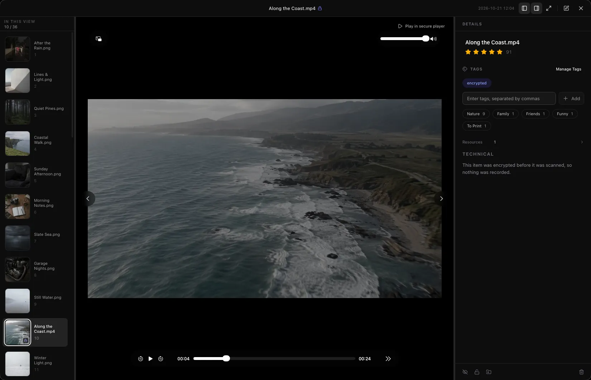

# LumenPod

[English](README.md) · [简体中文](README.zh-Hans.md) · [繁體中文](README.zh-Hant.md) · [日本語](README.ja.md)

**Mac のローカルメディアライブラリ。写真・動画・音声を整理し、見せたくないものは非表示や暗号化で保護できます。**

ファイルは元のフォルダに置いたまま、タグ・評価・コレクションで整理。暗号化した動画もアプリ内でそのまま再生できます。

[公式サイト](https://lumenpod.app/ja?utm_source=github&utm_medium=readme) · [ダウンロード・試用](https://lumenpod.app/ja?utm_source=github&utm_medium=readme#pricing) · [ヘルプ](https://lumenpod.app/ja/help?utm_source=github&utm_medium=readme) · [問題の報告](https://github.com/Prototaru/lumenpod/issues)

このリポジトリは不具合の報告と機能の提案を受け付けるためのものです。LumenPod はプロプライエタリソフトウェアであり、ソースコードは公開していません。

## 主な機能

- **ファイルを移動せずに写真・動画・音声を整理**：既存のフォルダを追加し、タグ・評価・好きな順番のコレクションで閲覧・再生できます。
- **外付けドライブのメディアカタログ**：外付けドライブやネットワークボリュームのコレクションを整理。ドライブを外してもカタログを確認でき、再接続すればファイルを開けます。
- **関連ファイルを一つの項目に**：同じ作品の別バージョン、カバー画像、字幕をまとめ、再生するファイルを選べます。ファイルが手元になくても作品を登録できます。
- **ローカル AI 検索**：モデルをダウンロードすれば、覚えている内容を自分の言葉で入力して写真を探したり、似た画像を検索したりできます。動画の検索は単一フレームに基づき、動画全体の内容検索ではありません。暗号化したメディアは対象外です。
- **Mac 上で字幕を生成**：動画や音声の英語・中国語・日本語の発話から字幕を生成。メディアはアップロードされません。別途 FFmpeg をインストールすると、暗号化されていない動画の字幕トラックの抽出・埋め込みもできます。
- **個別のパスワードで保護する暗号化領域**：選んだファイルを Mac 上で暗号化し、暗号化した動画を直接再生できます。非表示は普段の一覧での見え方を変え、暗号化はファイルの内容を保護します。
- **ローカルネットワークと WebDAV で共有**：ほかの端末のブラウザや WebDAV クライアントから公開メディアを読み取り専用で閲覧できます。共有にはパスワードがなく、非表示・暗号化したメディアは含まれません。Mac 間の同期機能ではありません。

## はじめに

[公式サイトから Mac 版をダウンロード](https://lumenpod.app/ja?utm_source=github&utm_medium=readme)し、アプリを Applications にドラッグしてください。Apple Silicon 搭載 Mac と macOS 14 以降が必要です。

料金と試用条件は[公式サイト](https://lumenpod.app/ja?utm_source=github&utm_medium=readme#pricing)をご覧ください。[ヘルプ](https://lumenpod.app/ja/help?utm_source=github&utm_medium=readme)と[リリースノート（英語）](https://lumenpod.app/changelog?utm_source=github&utm_medium=readme)も用意しています。

## ガイド（英語）

- [Mac で外付けドライブのメディアを整理する](https://lumenpod.app/guides/catalog-external-hard-drives-mac?utm_source=github&utm_medium=readme)
- [ファイルを移動せずに写真・動画・音声を整理する](https://lumenpod.app/guides/organize-media-without-moving-files?utm_source=github&utm_medium=readme)
- [動画の別バージョン・カバー画像・字幕をまとめる](https://lumenpod.app/guides/organize-video-versions-subtitles-mac?utm_source=github&utm_medium=readme)
- [共用 Mac でプライベートなメディアを保護する](https://lumenpod.app/guides/keep-media-private-shared-mac?utm_source=github&utm_medium=readme)
- [Mac で暗号化した動画を再生する](https://lumenpod.app/guides/play-encrypted-videos-mac?utm_source=github&utm_medium=readme)

## フィードバックとサポート

不具合や機能の提案は [Issues](https://github.com/Prototaru/lumenpod/issues/new/choose) へ。macOS とアプリのバージョンを添えてください。ライセンス・支払い・返金・セキュリティに関するお問い合わせは [support@lumenpod.app](mailto:support@lumenpod.app) まで。公開 Issue にアクティベーションコード、注文番号、アカウントのメールアドレス、パスワードを投稿しないでください。

[プライバシーポリシー](https://lumenpod.app/ja/privacy) · [利用規約](https://lumenpod.app/ja/terms) · [使用許諾契約](https://lumenpod.app/ja/eula)

© 2026 LumenPod. All rights reserved. このリポジトリの文章・画像を許可なく再利用することはできません。
