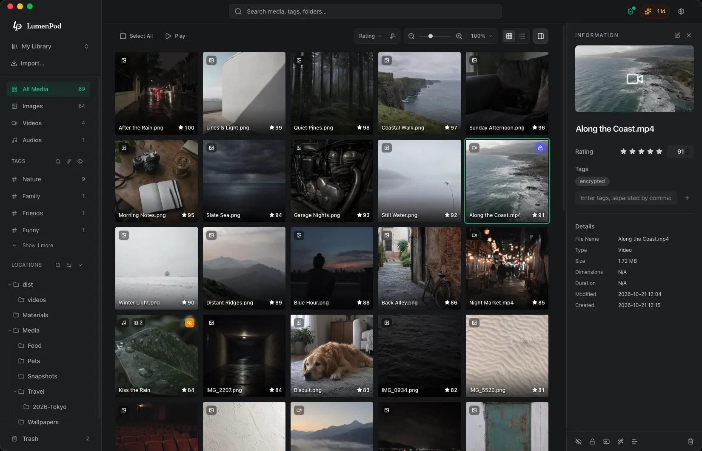

# LumenPod

[English](README.md) · [简体中文](README.zh-Hans.md) · [繁體中文](README.zh-Hant.md) · [日本語](README.ja.md)

LumenPod は Mac 用のローカルメディアライブラリです。写真・動画・音声を元の場所に置いたまま整理し、プライベートなメディアを非表示や暗号化で保護できます。

このリポジトリではダウンロード・ガイド・サポートへのリンクを案内し、不具合の報告や機能の提案を受け付けています。LumenPod はプロプライエタリソフトウェアであり、ソースコードは公開していません。

[ダウンロード・公式サイト](https://lumenpod.app/ja?utm_source=github&utm_medium=readme) · [ヘルプ](https://lumenpod.app/ja/help?utm_source=github&utm_medium=readme) · [リリースノート（英語）](https://lumenpod.app/changelog?utm_source=github&utm_medium=readme) · [Issues](https://github.com/Prototaru/lumenpod/issues)

Apple Silicon 搭載 Mac と macOS 14 以降が必要です。[料金と試用条件](https://lumenpod.app/ja?utm_source=github&utm_medium=readme#pricing)は公式サイトをご覧ください。

## 主な機能

- ファイルを移動せず、タグ・評価・好きな順番のコレクションで整理。
- 外付けドライブやネットワークボリュームをカタログ化。ドライブを外してもオフラインのカタログを閲覧可能。
- 動画の別バージョン・カバー画像・字幕を一つの項目に整理。
- 普段の一覧からメディアを非表示にしたり、個別のパスワードで保護する領域で暗号化したりできます。暗号化した動画もアプリ内で直接再生。
- ダウンロードしたローカル AI モデルで、説明文や似た画像から写真を検索。英語・中国語・日本語の音声から字幕も生成できます。動画検索は単一フレームに基づき、暗号化したメディアは AI 検索の対象外です。
- ブラウザや WebDAV を使い、ローカルネットワークで公開メディアを読み取り専用で共有。共有にはパスワードがなく、非表示・暗号化したメディアは含まれません。ライブラリの同期機能ではありません。

## ガイド（英語）

- [Mac で外付けドライブのメディアを整理する](https://lumenpod.app/guides/catalog-external-hard-drives-mac?utm_source=github&utm_medium=readme)
- [ファイルを移動せずに写真・動画・音声を整理する](https://lumenpod.app/guides/organize-media-without-moving-files?utm_source=github&utm_medium=readme)
- [動画の別バージョン・カバー画像・字幕をまとめる](https://lumenpod.app/guides/organize-video-versions-subtitles-mac?utm_source=github&utm_medium=readme)
- [共用 Mac でプライベートなメディアを保護する](https://lumenpod.app/guides/keep-media-private-shared-mac?utm_source=github&utm_medium=readme)
- [Mac で暗号化した動画を再生する](https://lumenpod.app/guides/play-encrypted-videos-mac?utm_source=github&utm_medium=readme)

## フィードバックとサポート

不具合や機能の提案は [Issues](https://github.com/Prototaru/lumenpod/issues/new/choose) へ。macOS とアプリのバージョンを添えてください。ライセンス・支払い・返金・セキュリティに関するお問い合わせは [support@lumenpod.app](mailto:support@lumenpod.app) まで。公開 Issue にアクティベーションコード、注文番号、アカウントのメールアドレス、パスワードを投稿しないでください。

[プライバシーポリシー](https://lumenpod.app/ja/privacy) · [利用規約](https://lumenpod.app/ja/terms) · [使用許諾契約](https://lumenpod.app/ja/eula)

© 2026 LumenPod. All rights reserved. このリポジトリの文章・画像を許可なく再利用することはできません。
