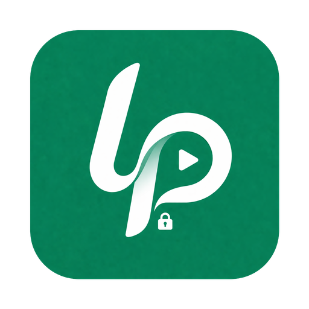
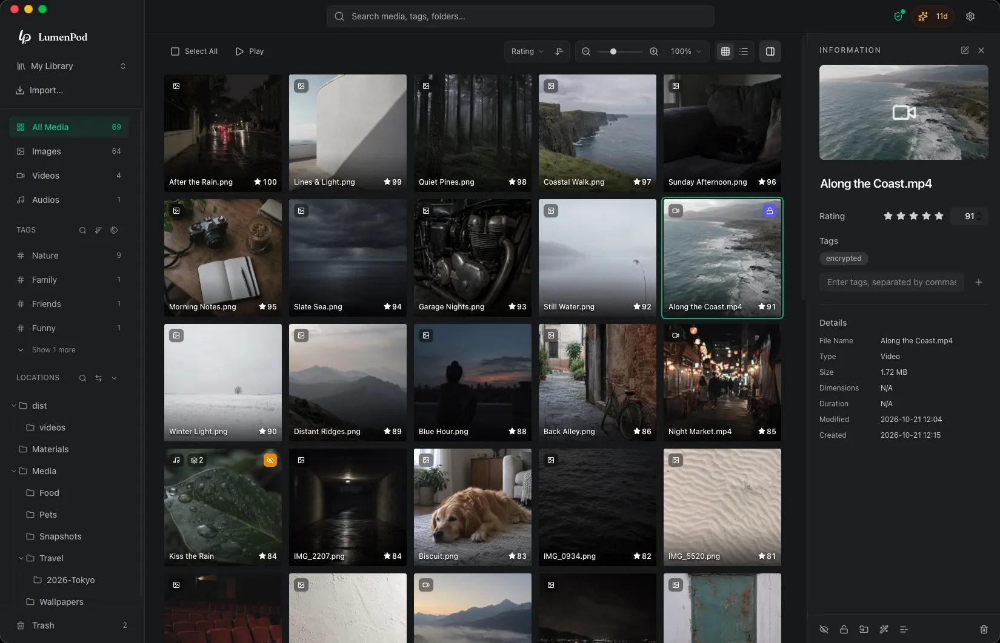
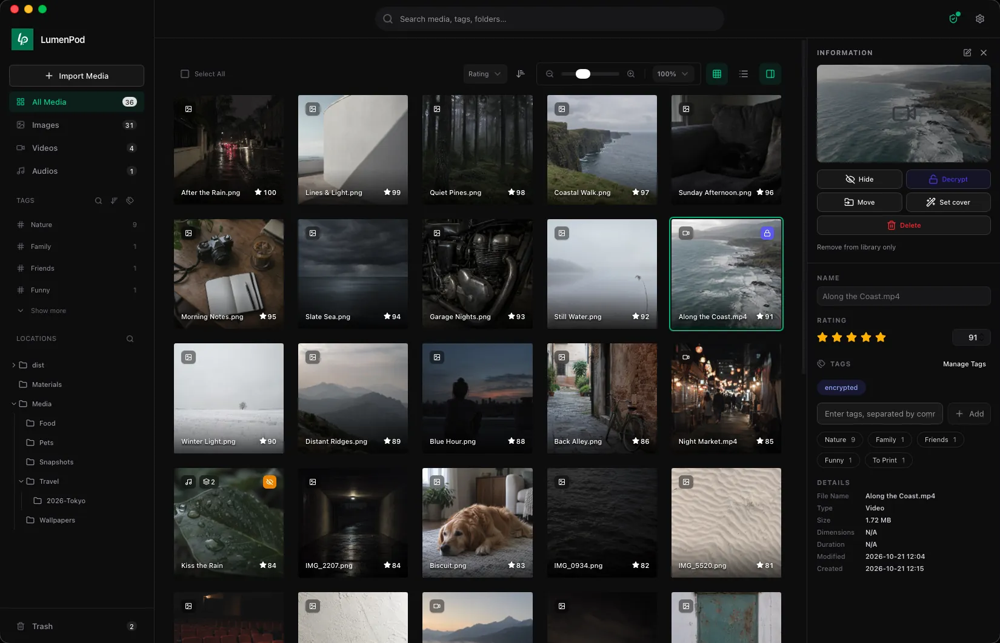
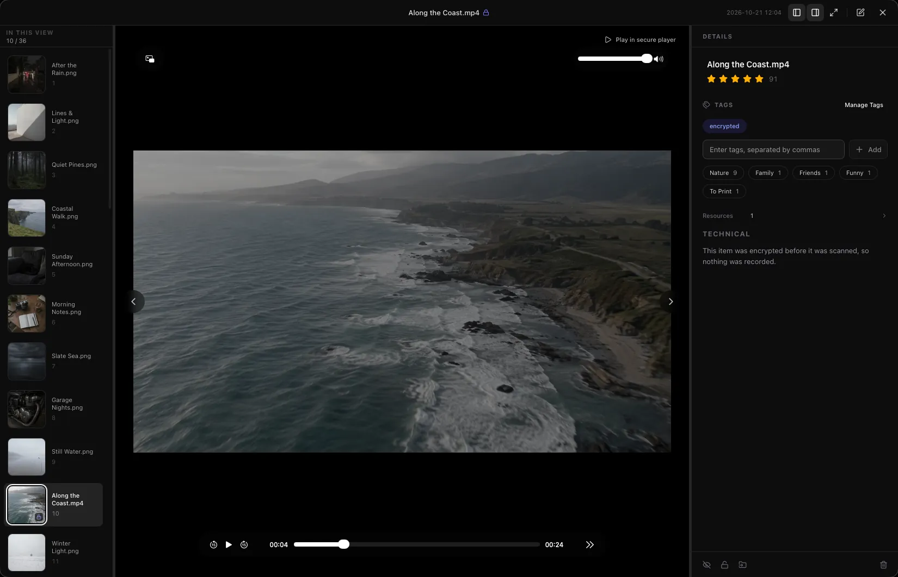

  

<h1 align="center">LumenPod</h1>

[English](README.md) · [简体中文](README.zh-Hans.md) · [繁體中文](README.zh-Hant.md) · [日本語](README.ja.md)

  <strong>A local media library for Mac.</strong> 
  Organize your photos, videos and audio without moving files. 
  Hide and encrypt what’s private, and play encrypted videos right in the app.

  <a href="https://lumenpod.app/?utm_source=github&utm_medium=readme">Website</a> ·
  <a href="#get-started">Download</a> ·
  <a href="https://lumenpod.app/guides?utm_source=github&utm_medium=readme">Guides</a> ·
  <a href="https://lumenpod.app/support?utm_source=github&utm_medium=readme">Support</a> ·
  <a href="https://github.com/Prototaru/lumenpod/issues">Issues</a>

> **About this repository.** This is LumenPod's public home on GitHub: bug reports and
> feature requests. LumenPod is proprietary software — the source code is not published here.

## What LumenPod does

### Organize images, videos and audio without moving files

Add folders from your Mac and LumenPod catalogs them where they are. Your originals stay in
their folders; importing does not copy, move or encrypt anything on its own. Browse images,
videos and audio from one library, and organize them by your own tags and ratings instead of
rearranging folders.

### Catalog media on external hard drives

Add folders from external and network volumes. Unplug a drive and its media stays in the
library, marked offline, along with the drive it lives on. Plug it back in to open the files.

### Keep every copy, cover and subtitle as one item

A collected work often comes with several files. Keep them together as one item: for a film,
the original, a lighter copy, a poster and subtitles. Choose which copy plays, merge two items
into one or split a file back out, and add a title by name before you have its file.

### Find things again

Search media, tags and folders. Rate items on a 0–100 scale, stack tags to narrow the view,
and step through what you filtered in the built-in image viewer and video/audio player.
Create collections in your own order and play them start to finish.

With a downloadable model, search photos by describing what you remember in your own
language, or find similar images. AI runs locally on your Mac. Video matches use a single
frame, not the whole video; encrypted media is excluded.

### Generate subtitles on your Mac

Turn speech in video or audio into subtitles in English, Chinese or Japanese, without
uploading your media. Generated subtitles are saved next to the media. You can also extract
or embed subtitle tracks in unencrypted videos using FFmpeg, which you install separately.

### Locally encrypted vaults

Encrypt selected files on your Mac. Each password opens its own vault, and vault keys never
leave your Mac — LumenPod servers don't hold them. Encrypted video plays inside the app. Keep a
second, still-encrypted copy of a vault on another drive, and export recovery data with a
separate key file.

You can also hide selected media from everyday browsing. Hiding controls visibility;
encryption protects file contents — they are different tools.

### Browse from another device on your network

Start **Browser & WebDAV** sharing to browse your public media from a browser or a WebDAV
client on your local network. The share is read-only and has no password, and it never
includes encrypted or hidden media. It is access, not sync: LumenPod does not synchronize
libraries between Macs.

<table>
  <tr>
    <td></td>
    <td></td>
  </tr>
  <tr>
    <td align="center">Details, tags and ratings</td>
    <td align="center">Encrypted video plays in the app</td>
  </tr>
</table>

## Get started

[Download LumenPod for Mac](https://lumenpod.app/?utm_source=github&utm_medium=readme)
and drag it into **Applications**. Requires macOS 14 or later on Apple Silicon.

See the website for [pricing and trial details](https://lumenpod.app/?utm_source=github&utm_medium=readme#pricing),
the [Help Center](https://lumenpod.app/help?utm_source=github&utm_medium=readme)
and [release notes](https://lumenpod.app/changelog?utm_source=github&utm_medium=readme).

## Guides

- [Catalog Media on External Hard Drives on Mac](https://lumenpod.app/guides/catalog-external-hard-drives-mac?utm_source=github&utm_medium=readme)
- [Organize Images, Videos and Audio Without Moving Files](https://lumenpod.app/guides/organize-media-without-moving-files?utm_source=github&utm_medium=readme)
- [Organize Video Versions, Cover Art and Subtitles on Mac](https://lumenpod.app/guides/organize-video-versions-subtitles-mac?utm_source=github&utm_medium=readme)
- [Share Local Media from Mac over LAN and WebDAV](https://lumenpod.app/guides/share-local-media-webdav-mac?utm_source=github&utm_medium=readme)
- [Keep Media Private on a Shared Mac](https://lumenpod.app/guides/keep-media-private-shared-mac?utm_source=github&utm_medium=readme)
- [Play Encrypted Videos on Mac](https://lumenpod.app/guides/play-encrypted-videos-mac?utm_source=github&utm_medium=readme)
- [How to Password-Lock Photos, Videos and Audio on Mac](https://lumenpod.app/guides/keep-photos-private-on-mac?utm_source=github&utm_medium=readme)

## Feedback and support

- **Bugs and feature requests:** [open an issue](https://github.com/Prototaru/lumenpod/issues/new/choose). Include your macOS
  version and LumenPod version (Settings → About).
- **License, billing and refunds:** email [support@lumenpod.app](mailto:support@lumenpod.app).
  Never post activation codes, order numbers or your account email in a public issue.
- **Security issues:** email [support@lumenpod.app](mailto:support@lumenpod.app?subject=Security%20report)
  instead of opening a public issue.

## License

LumenPod is proprietary software. © 2026 LumenPod. All rights reserved.
[Privacy Policy](https://lumenpod.app/privacy) ·
[Terms of Service](https://lumenpod.app/terms) ·
[End User License Agreement](https://lumenpod.app/eula)

The text and images in this repository may not be reused without permission.
