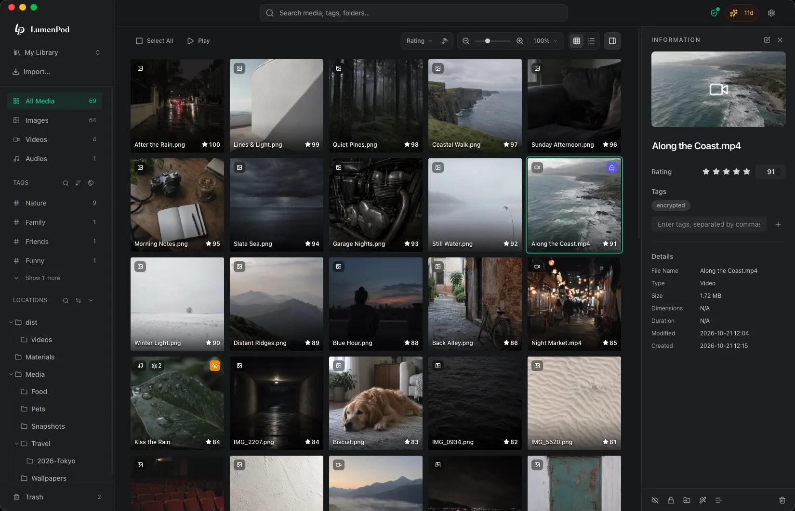

# LumenPod

[English](README.md) · [简体中文](README.zh-Hans.md) · [繁體中文](README.zh-Hant.md) · [日本語](README.ja.md)

LumenPod 是为个人收藏打造的 Mac 本地媒体库。原地整理照片、视频和音频，并用加密保护私密内容。

[下载与官网](https://lumenpod.app/zh-hans?utm_source=github&utm_medium=referral&utm_campaign=cold_start_v1) · [帮助中心](https://lumenpod.app/zh-hans/help?utm_source=github&utm_medium=referral&utm_campaign=cold_start_v1) · [更新记录（英文）](https://lumenpod.app/changelog?utm_source=github&utm_medium=referral&utm_campaign=cold_start_v1) · [问题反馈](https://github.com/Prototaru/lumenpod/issues)

14 天全功能试用 · 一次买断。需要 Apple Silicon Mac 和 macOS 14 或更新版本。 [价格与试用说明](https://lumenpod.app/zh-hans?utm_source=github&utm_medium=referral&utm_campaign=cold_start_v1#pricing)

## 为什么选择 LumenPod？

- **文件留在原处。** 为 Mac、外接硬盘和网络卷中的媒体建立目录，硬盘断开后仍可浏览离线目录。
- **相关视频文件放在一起。** 将不同版本、封面与字幕归为一个条目，浏览收藏时不再散落成多个文件。
- **保护私密收藏。** 从日常浏览中隐藏媒体，或用独立密码的加密空间保护文件；加密视频可在应用内直接播放。

## 更多收藏方式

- 通过标签、评分和自定义顺序的集合整理收藏。
- 下载本地 AI 模型后，通过描述或相似图片查找照片。
- 将英语、中文或日语语音生成字幕。
- 通过浏览器或 WebDAV 在局域网内只读分享公开媒体。

## 试用前了解

- 视频 AI 搜索基于单帧；加密媒体不参与 AI 搜索。
- 局域网共享没有密码，不包含隐藏或加密内容，不提供媒体库同步。
- 试用结束后，浏览、播放、导出、解密及已有加密空间解锁仍免费；离线硬盘浏览等 Pro 功能需要付费许可证。

## 使用指南（英文）

- [在 Mac 上整理外接硬盘中的媒体](https://lumenpod.app/guides/catalog-external-hard-drives-mac?utm_source=github&utm_medium=referral&utm_campaign=cold_start_v1)
- [不移动文件地整理照片、视频和音频](https://lumenpod.app/guides/organize-media-without-moving-files?utm_source=github&utm_medium=referral&utm_campaign=cold_start_v1)
- [整理视频版本、封面与字幕](https://lumenpod.app/guides/organize-video-versions-subtitles-mac?utm_source=github&utm_medium=referral&utm_campaign=cold_start_v1)
- [保护共用 Mac 上的私密媒体](https://lumenpod.app/guides/keep-media-private-shared-mac?utm_source=github&utm_medium=referral&utm_campaign=cold_start_v1)
- [在 Mac 上播放加密视频](https://lumenpod.app/guides/play-encrypted-videos-mac?utm_source=github&utm_medium=referral&utm_campaign=cold_start_v1)

## 反馈与支持

本仓库提供下载、使用指南和支持入口，并接受问题反馈与功能建议。LumenPod 是闭源专有软件，此处不提供源代码。

通过 [Issues](https://github.com/Prototaru/lumenpod/issues/new/choose) 报告问题或提出建议，请附上 macOS 和应用版本。授权、付款、退款与安全问题请联系 [support@lumenpod.app](mailto:support@lumenpod.app)。不要在公开 Issue 中发布激活码、订单号、账户邮箱或密码。

[隐私政策](https://lumenpod.app/zh-hans/privacy?utm_source=github&utm_medium=referral&utm_campaign=cold_start_v1) · [服务条款](https://lumenpod.app/zh-hans/terms?utm_source=github&utm_medium=referral&utm_campaign=cold_start_v1) · [最终用户许可协议](https://lumenpod.app/zh-hans/eula?utm_source=github&utm_medium=referral&utm_campaign=cold_start_v1)

© 2026 LumenPod。保留所有权利。未经许可，不得复用本仓库中的文字与图片。
