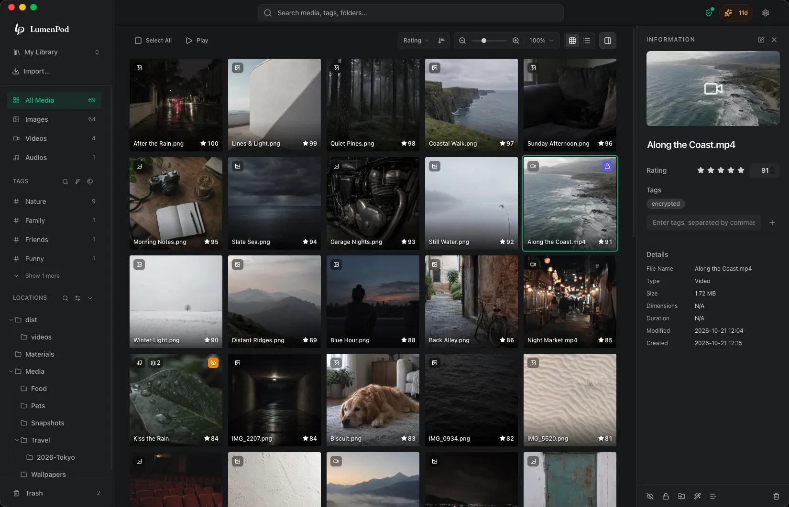

# LumenPod

[English](README.md) · [简体中文](README.zh-Hans.md) · [繁體中文](README.zh-Hant.md) · [日本語](README.ja.md)

LumenPod 是 Mac 本機媒體庫，可原地整理照片、影片與音訊，並隱藏或加密私密內容。

本儲存庫提供下載、使用指南與支援入口，並接受問題回報與功能建議。LumenPod 是閉源專有軟體，此處不提供原始碼。

[下載與官網](https://lumenpod.app/zh-hant?utm_source=github&utm_medium=readme) · [說明中心](https://lumenpod.app/zh-hant/help?utm_source=github&utm_medium=readme) · [更新紀錄（英文）](https://lumenpod.app/changelog?utm_source=github&utm_medium=readme) · [問題回報](https://github.com/Prototaru/lumenpod/issues)

需要 Apple Silicon Mac 與 macOS 14 或更新版本。[價格與試用說明](https://lumenpod.app/zh-hant?utm_source=github&utm_medium=readme#pricing)請見官網。

## 主要功能

- 不移動原始檔案，透過標籤、評分與自訂順序的收藏集整理收藏。
- 為外接硬碟與網路磁碟區建立媒體目錄，拔除硬碟後仍可查看離線目錄。
- 將影片的不同版本、封面與字幕歸為一個項目。
- 從日常瀏覽中隱藏媒體，或以獨立密碼的加密空間保護檔案；加密影片可在應用程式內直接播放。
- 下載本機 AI 模型後，透過描述或相似圖片尋找照片，並將英語、中文或日語語音產生字幕。影片搜尋以單一影格為依據；加密媒體不參與 AI 搜尋。
- 透過瀏覽器或 WebDAV 在區域網路內唯讀分享公開媒體。分享沒有密碼，不包含隱藏或加密內容，不提供媒體庫同步。

## 使用指南（英文）

- [在 Mac 上整理外接硬碟中的媒體](https://lumenpod.app/guides/catalog-external-hard-drives-mac?utm_source=github&utm_medium=readme)
- [不移動檔案地整理照片、影片與音訊](https://lumenpod.app/guides/organize-media-without-moving-files?utm_source=github&utm_medium=readme)
- [整理影片版本、封面與字幕](https://lumenpod.app/guides/organize-video-versions-subtitles-mac?utm_source=github&utm_medium=readme)
- [保護共用 Mac 上的私密媒體](https://lumenpod.app/guides/keep-media-private-shared-mac?utm_source=github&utm_medium=readme)
- [在 Mac 上播放加密影片](https://lumenpod.app/guides/play-encrypted-videos-mac?utm_source=github&utm_medium=readme)

## 意見回饋與支援

透過 [Issues](https://github.com/Prototaru/lumenpod/issues/new/choose) 回報問題或提出建議，請附上 macOS 與應用程式版本。授權、付款、退款與安全問題請聯絡 [support@lumenpod.app](mailto:support@lumenpod.app)。請勿在公開 Issue 中發布啟用碼、訂單編號、帳號電子郵件或密碼。

[隱私權政策](https://lumenpod.app/zh-hant/privacy) · [服務條款](https://lumenpod.app/zh-hant/terms) · [終端使用者授權合約](https://lumenpod.app/zh-hant/eula)

© 2026 LumenPod。保留所有權利。未經許可，不得重用本儲存庫中的文字與圖片。
